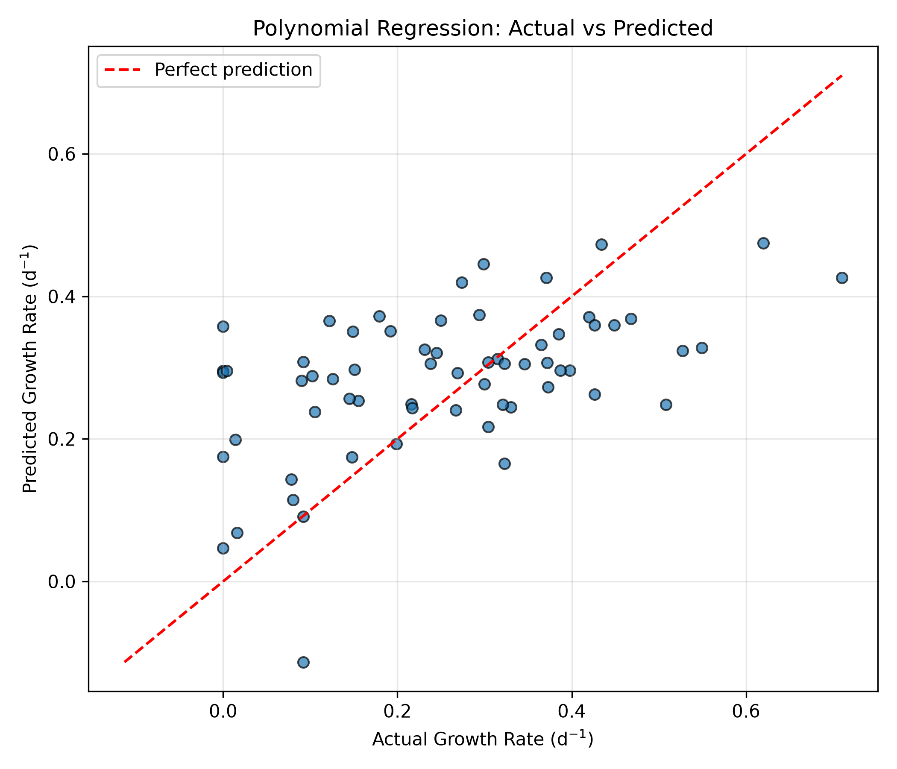
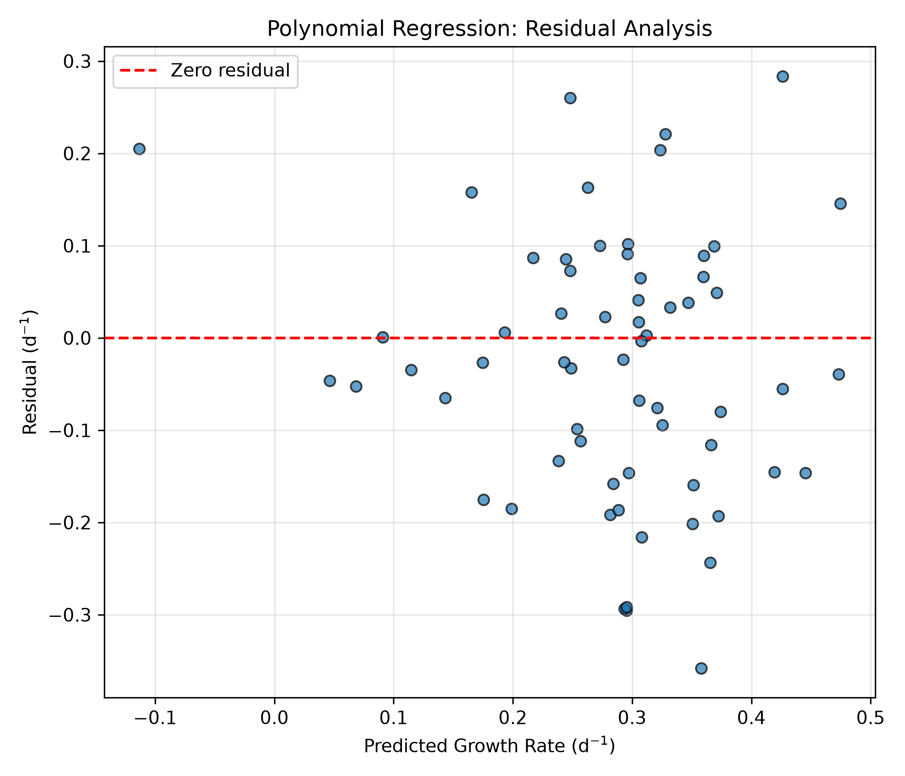
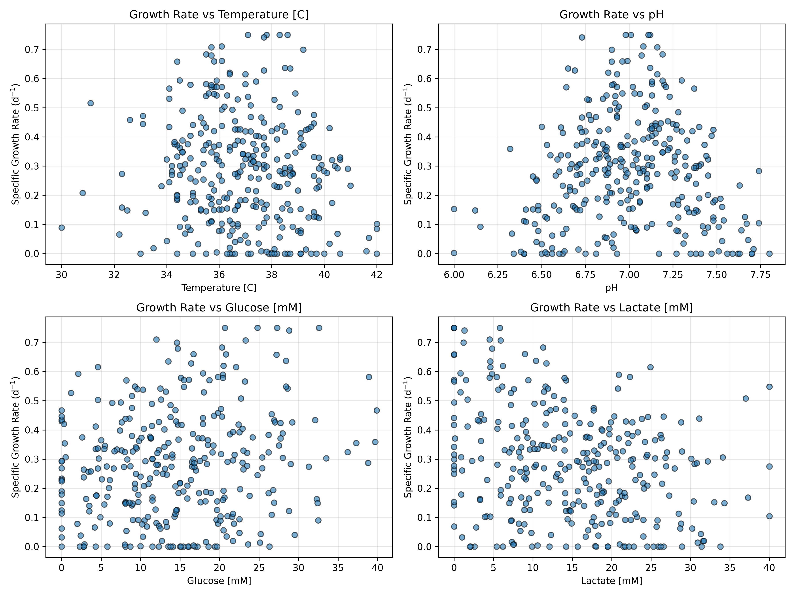

# Assignment 2: Machine Learning for Cell Growth Rate Prediction

## Project Overview

This project investigates the application of machine learning techniques to predict the specific growth rate of cells using experimental bioprocess data. The objective is to develop, optimize, and compare regression models capable of predicting cell growth based on four process variables: temperature, pH, glucose concentration, and lactate concentration.

The dataset contains 318 observations and is divided into training (80%) and testing (20%) subsets.

Three machine learning approaches are investigated:

- **Polynomial Regression:** Captures nonlinear relationships between process variables and cell growth rate.
- **K-Nearest Neighbors (KNN) Regression:** Predicts growth rate based on similarities between observations.
- **Random Forest Regression:** Combines multiple decision trees to model complex relationships between input variables and cell growth.

Model hyperparameters are optimized using GridSearchCV and cross-validation. Predictive performance is evaluated using Mean Absolute Error (MAE), Root Mean Squared Error (RMSE), and the coefficient of determination (R²).

The project also includes exploratory data visualization, predicted-versus-actual comparisons, residual analysis, and a consolidated model comparison table.

## Methodology

### 1. Data Preparation

The dataset contains 318 observations and five numerical variables. Four variables are used as input features:

- Temperature (°C)
- pH
- Glucose concentration (mM)
- Lactate concentration (mM)

The target variable is the specific growth rate (d⁻¹).

The dataset is divided into 254 training observations (80%) and 64 testing observations (20%). The training set is used to develop the models, while the testing set is reserved for evaluating their predictive performance on unseen data.

### 2. Machine Learning Models

Three regression algorithms are implemented and compared.

**Polynomial Regression**

Polynomial Regression extends linear regression by introducing polynomial features to capture nonlinear relationships between the input variables and specific growth rate. A second-degree polynomial is selected through hyperparameter optimization.

**K-Nearest Neighbors (KNN) Regression**

KNN is a distance-based regression algorithm that estimates the target variable using neighboring observations. GridSearchCV identifies 15 neighbors with distance-based weighting as the best configuration among the tested parameters.

**Random Forest Regression**

Random Forest is an ensemble learning algorithm that combines predictions from multiple decision trees. The optimized configuration uses 100 trees, a maximum tree depth of 8, and a minimum of 4 samples per leaf.

### 3. Hyperparameter Optimization

GridSearchCV is used with cross-validation to identify suitable hyperparameters for each regression model. The optimization criterion is Root Mean Squared Error (RMSE), with lower values indicating better predictive accuracy.

### 4. Model Evaluation

The optimized models are evaluated on the testing dataset using three performance metrics:

- **Mean Absolute Error (MAE):** Measures the average absolute difference between actual and predicted growth rates.
- **Root Mean Squared Error (RMSE):** Measures prediction error while assigning greater weight to larger deviations.
- **Coefficient of Determination (R²):** Measures how much of the variability in the observed growth rate is explained by the model.

Lower MAE and RMSE values indicate better predictive performance, while higher R² values generally indicate better model fit.

## Code Design

### 1. Overall Program Architecture

The Python program is designed using a modular approach that separates the main execution workflow from the implementation of individual machine learning operations. The main script, `main.py`, serves as the central entry point of the application, while the supporting functions are imported from `src/functions.py`.

This architecture improves code organization, readability, and maintainability. Instead of implementing every operation directly in the main script, the program calls dedicated functions responsible for data preparation, model training, hyperparameter optimization, visualization, and results export.

The `main()` function controls the sequence of operations, ensuring that all regression models are trained and evaluated using the same dataset partition.

### 2. Data Loading and Preparation

The program begins by calling `load_data()` to obtain the experimental cell growth dataset. The `split_features_target()` function separates the independent variables from the target variable.

The input features represent four bioprocess operating conditions: temperature, pH, glucose concentration, and lactate concentration. The target variable is the specific growth rate of cells.

The `prepare_data()` function divides the observations into training and testing datasets. The resulting variables, `X_train`, `X_test`, `y_train`, and `y_test`, are reused throughout the program.

This approach ensures that all three regression algorithms are evaluated using consistent training and testing subsets, allowing meaningful performance comparisons.

### 3. Regression Model Implementation

Three machine learning algorithms are implemented through dedicated training functions.

The Polynomial Regression model is initialized using `train_polynomial_model()`. Predictions are generated using the model's `predict()` method and compared against the observed testing values.

The K-Nearest Neighbors regression model follows the same workflow through `train_knn_model()`. This consistency makes the code easier to understand and allows the two algorithms to be compared using identical evaluation metrics.

The Random Forest model is implemented through `train_random_forest()`. Like the other models, it generates predictions on the testing dataset, which are then evaluated quantitatively.

Each model is trained independently, while the data preparation and evaluation procedures remain consistent.

### 4. Hyperparameter Optimization

The program includes three dedicated optimization functions: `optimize_knn_model()`, `optimize_polynomial_model()`, and `optimize_random_forest()`.

Each function returns a fitted hyperparameter search object containing the best model configuration, optimal parameters, and cross-validation performance.

The `best_params_` attribute identifies the selected hyperparameters, while `best_score_` provides the optimization score. The program converts the negative cross-validation score into a positive RMSE value for reporting.

The optimized estimator is accessed using `best_estimator_`, allowing the selected model to generate predictions on the independent testing dataset.

Separating optimization into individual functions improves the flexibility of the program because model-specific search configurations can be adjusted without substantially changing the main execution workflow.

### 5. Model Performance Evaluation

The program evaluates regression performance using three metrics from `sklearn.metrics`: Mean Absolute Error, Mean Squared Error, and the coefficient of determination.

MAE is calculated using `mean_absolute_error()`, while RMSE is obtained by taking the square root of the output from `mean_squared_error()`. The R² score is calculated using `r2_score()`.

These metrics provide complementary information about prediction accuracy. MAE represents the average absolute prediction error, RMSE emphasizes larger errors, and R² describes the proportion of variability explained by the model.

The program prints performance metrics for the initially trained models and evaluates the optimized Random Forest separately. A final comparison of all three optimized models is generated through `save_model_comparison()`.

This function produces a consolidated results table, which is exported to `tables/model_comparison.csv`.

### 6. Data Visualization

Three visualization functions are integrated into the main workflow.

The `plot_actual_vs_predicted()` function generates a comparison between observed and predicted specific growth rates. The optimized Polynomial Regression model is selected for this visualization using `poly_search.best_estimator_`.

The `plot_residuals()` function examines prediction errors for the same optimized model. Residual analysis helps identify deviations between model predictions and experimental observations.

The `plot_feature_relationships()` function generates exploratory visualizations showing the relationships between the input variables and specific growth rate.

The resulting figures are stored in the `figures/` directory, making them accessible for interpretation and documentation.

### 7. Program Execution and Maintainability

The program uses the standard Python execution condition `if __name__ == "__main__":` to call `main()` when the script is executed directly.

This structure keeps the main workflow clearly defined and prevents automatic execution when the file is imported as a module.

Descriptive variable names, comments, and separate functions improve readability and make it easier to identify the purpose of each operation.

Overall, the modular organization provides a foundation for future improvements, including additional regression algorithms, alternative evaluation methods, and more advanced data visualization techniques.

## Analysis

### 1. Introduction to Model Performance Analysis

The primary objective of this project was to investigate the ability of machine learning regression algorithms to predict the specific growth rate of cells using four bioprocess variables: temperature, pH, glucose concentration, and lactate concentration. Three algorithms were considered: Polynomial Regression, K-Nearest Neighbors (KNN) Regression, and Random Forest Regression.

The dataset contained 318 observations, of which 254 were used for training and 64 for testing. All models were evaluated using the same testing dataset to ensure a consistent comparison of predictive performance.

The analysis focuses on three evaluation metrics: Mean Absolute Error (MAE), Root Mean Squared Error (RMSE), and the coefficient of determination (R²). In addition, cross-validation results, graphical representations, and model limitations are considered to evaluate the strengths and weaknesses of each approach.

### 2. Comparison of Regression Models

The optimized models produced the following results:

| Model | CV RMSE (d⁻¹) | Test MAE (d⁻¹) | Test RMSE (d⁻¹) | Test R² |
|---|---:|---:|---:|---:|
| Polynomial Regression | 0.1599 | 0.1173 | 0.1455 | 0.2214 |
| KNN Regression | 0.1603 | 0.1220 | 0.1474 | 0.2011 |
| Random Forest Regression | 0.1545 | 0.1179 | 0.1517 | 0.1539 |

Polynomial Regression achieved the best performance on the testing dataset, producing the lowest MAE and RMSE values and the highest R² score. Its RMSE of 0.1455 d⁻¹ indicates that the typical magnitude of prediction errors, with larger deviations receiving greater weight, was approximately 0.1455 d⁻¹.

KNN Regression achieved a slightly higher RMSE of 0.1474 d⁻¹, representing a relatively small difference compared with Polynomial Regression. Its R² value of 0.2011 suggests that the model explained approximately 20.11% of the observed variation in the testing dataset.

Random Forest Regression produced a testing RMSE of 0.1517 d⁻¹ and an R² of 0.1539. Although this model achieved the lowest cross-validation RMSE, its testing performance was weaker than that of the other two algorithms.

The differences between the models are relatively small in absolute terms. Consequently, the results do not establish that one algorithm would consistently outperform the others on every independent dataset.

### 3. Polynomial Regression Analysis

Polynomial Regression extends conventional linear regression by introducing nonlinear terms and interactions between input variables. This approach is useful when the relationship between operating conditions and cell growth rate cannot be represented adequately by a simple linear equation.

In biochemical processes, growth behavior may depend on nonlinear responses to environmental conditions. For example, temperature and pH can influence enzyme activity and cellular metabolism, while glucose availability and lactate accumulation can affect growth through nutrient availability and metabolic stress.

Polynomial Regression provides a mathematical framework capable of representing some of these nonlinear relationships.

The optimized Polynomial Regression model achieved an MAE of 0.1173 d⁻¹, an RMSE of 0.1455 d⁻¹, and an R² of 0.2214.

These results indicate that Polynomial Regression performed better than the other evaluated algorithms on the testing dataset. However, its relatively low R² value demonstrates that a substantial portion of the observed variability remains unexplained.

One possible explanation is that the relationship between the selected variables and growth rate is more complex than the polynomial model can represent. Other biological factors, measurement variability, or interactions not fully captured by the model may contribute to prediction errors.

Polynomial Regression also has limitations related to model complexity. Increasing polynomial degree introduces additional features, which may improve flexibility but can also increase the risk of overfitting. Hyperparameter optimization helps manage this trade-off by comparing candidate configurations through cross-validation.

### 4. K-Nearest Neighbors Regression Analysis

KNN Regression is a nonparametric machine learning method that predicts an output based on observations with similar input characteristics.

Unlike Polynomial Regression, KNN does not assume a specific mathematical relationship between the input variables and the target. Instead, predictions are determined by the values of neighboring observations in the feature space.

This approach can be useful when observations with similar operating conditions exhibit similar growth behavior.

The optimized KNN model achieved an MAE of 0.1220 d⁻¹, an RMSE of 0.1474 d⁻¹, and an R² of 0.2011.

These values indicate that KNN achieved predictive performance close to Polynomial Regression, although its testing errors were slightly higher.

An important consideration for KNN is its sensitivity to feature scaling. Since temperature, pH, glucose concentration, and lactate concentration have different numerical ranges and units, the model incorporates StandardScaler to standardize the input features before calculating distances. This preprocessing step prevents variables with larger numerical scales from disproportionately influencing neighbor selection. By integrating StandardScaler within the machine learning pipeline, scaling parameters are learned from the appropriate training data during cross-validation, helping prevent data leakage.

### 5. Random Forest Regression Analysis

Random Forest Regression is an ensemble learning method that combines predictions from multiple decision trees.

Each tree learns decision rules based on the training data, and the final regression prediction is obtained by averaging predictions across the ensemble.

Random Forest can represent nonlinear relationships and interactions between variables without requiring a predefined polynomial equation.

In this project, Random Forest achieved the lowest cross-validation RMSE of 0.1545 d⁻¹. However, its testing RMSE was 0.1517 d⁻¹, and its testing R² was 0.1539.

This difference illustrates an important aspect of machine learning evaluation: a model that performs best during cross-validation does not necessarily achieve the best performance on a particular independent testing dataset.

Cross-validation estimates performance using different subsets of the training data, whereas the final testing results depend on the specific observations held out for evaluation.

Random Forest may also have difficulty predicting observations with combinations of operating conditions that are poorly represented in the training dataset. Decision-tree-based regression models generally rely on patterns observed during training rather than extrapolating smoothly beyond the observed data.

Although Random Forest is flexible, increased model complexity does not automatically produce better predictive accuracy. The available data must contain sufficiently informative relationships for the algorithm to learn.

### 6. Cross-Validation and Generalization

Cross-validation is an important component of this project because it provides a more systematic approach to hyperparameter selection than evaluating candidate models using only one training and validation split.

The optimized cross-validation RMSE values were 0.1599 d⁻¹ for Polynomial Regression, 0.1603 d⁻¹ for KNN, and 0.1545 d⁻¹ for Random Forest.

These values indicate that Random Forest performed best according to the cross-validation optimization criterion, while Polynomial Regression achieved the best results on the held-out testing dataset.

The difference between these rankings demonstrates why both cross-validation and independent test evaluation are necessary.

Cross-validation helps select model configurations without using the final testing dataset during optimization. The testing dataset then provides an additional assessment of predictive performance on observations that were not used to fit or select the models.

However, the testing dataset contains only 64 observations. Performance estimates may therefore vary if the experiment is repeated with a different train-test split.

Additional independent datasets or repeated evaluation procedures would provide stronger evidence about which algorithm generalizes most reliably.

### 7. Actual Versus Predicted Growth Rate

The actual-versus-predicted figure compares the observed specific growth rates with predictions generated by the optimized Polynomial Regression model.

An ideal regression model would produce predictions close to the corresponding observed values. On a scatter plot, this would place the points near the identity line, where predicted values equal actual values.

The observed scatter indicates that the model does not reproduce all variations in growth rate accurately.

Some observations are predicted more closely than others, suggesting that the selected model captures part of the relationship between operating conditions and growth but leaves substantial unexplained variation.

This observation is consistent with the R² value of 0.2214.

The figure provides a useful visual complement to the numerical performance metrics because it illustrates the distribution of prediction errors rather than reducing performance to a single summary statistic.

### 8. Residual Analysis

Residual analysis provides additional information about model prediction errors. A residual is defined as the difference between an observed value and its corresponding predicted value.

For an accurate model, residuals should generally be small and should not exhibit strong systematic patterns.

The residual analysis figure for Polynomial Regression shows prediction errors on both sides of zero.

The presence of relatively large residuals indicates that some growth-rate observations are not predicted accurately.

Several factors could contribute to these deviations, including experimental measurement variability, missing explanatory variables, and model limitations.

Residual analysis is particularly important because a model can produce an acceptable average error while still performing poorly for certain observations.

Further investigation of residual patterns could help determine whether prediction errors depend on particular growth-rate ranges or operating conditions.

### 9. Biological Interpretation and Model Limitations

Cell growth is influenced by complex biological and environmental mechanisms.

Temperature affects biochemical reaction rates and protein stability, while pH can influence enzyme activity and cellular homeostasis. Glucose is an important nutrient for many cell culture systems, whereas lactate accumulation may reflect metabolic activity and, under some conditions, contribute to growth inhibition.

These mechanisms provide scientific reasons to investigate the four selected variables as potential predictors of specific growth rate.

However, growth rate may also depend on other factors, including dissolved oxygen, nutrient availability, cell density, culture history, and metabolic state.

Because these additional variables are not included among the four predictors in this project, the models may lack information needed to explain the full variability in growth rate.

The limited dataset size may also affect model reliability. With 318 observations, the models have a finite amount of information available for learning potentially complex relationships.

The results should therefore be interpreted as an evaluation of predictive modeling approaches rather than evidence that the selected model can reliably predict growth under all bioprocess conditions.

### 10. Recommendations for Future Improvement

Several improvements could be investigated in future work.

First, additional relevant bioprocess measurements could be incorporated into the dataset. Variables such as dissolved oxygen, cell density, and other nutrient or metabolite concentrations may provide information that is not captured by the current four inputs.

Second, additional feature engineering could be investigated to represent interactions or transformations that are meaningful from a biochemical engineering perspective.

Third, feature scaling should be examined carefully for distance-based methods such as KNN, because the numerical ranges of the input variables can influence the resulting predictions.

Fourth, additional independent experimental observations would help evaluate whether the model performance remains consistent across different operating conditions.

Finally, alternative machine learning algorithms and repeated validation strategies could be compared to determine whether improvements in predictive accuracy are possible.

### 11. Overall Interpretation

The results demonstrate that machine learning methods can be implemented systematically to investigate relationships between bioprocess conditions and specific cell growth rate.

Polynomial Regression achieved the strongest testing performance among the three evaluated algorithms, while Random Forest achieved the lowest cross-validation RMSE.

Nevertheless, all three models produced relatively low R² values, indicating limited explanatory and predictive capability.

The main outcome of this project is therefore not only the identification of the best-performing model on the testing dataset, but also the demonstration of how model selection, cross-validation, quantitative evaluation, and residual analysis can be combined to assess the reliability of machine learning predictions in biochemical engineering.

## Results and Discussion

### 1. Model Performance Comparison

Three regression models were optimized and evaluated using the same testing dataset of 64 observations.

| Model | CV RMSE (d⁻¹) | Test MAE (d⁻¹) | Test RMSE (d⁻¹) | Test R² |
|---|---:|---:|---:|---:|
| KNN Regression | 0.1603 | 0.1220 | 0.1474 | 0.2011 |
| Polynomial Regression | 0.1599 | 0.1173 | 0.1455 | 0.2214 |
| Random Forest Regression | 0.1545 | 0.1179 | 0.1517 | 0.1539 |

### 2. Best Performing Model

Polynomial Regression achieved the best predictive performance on the testing dataset, with the lowest MAE (0.1173 d⁻¹), lowest RMSE (0.1455 d⁻¹), and highest R² (0.2214).

Although Random Forest achieved the lowest cross-validation RMSE (0.1545 d⁻¹), it performed less effectively on the independent testing dataset. This illustrates that cross-validation performance does not always translate directly into better test-set predictions.

The relatively low R² values indicate that all three models have limited predictive capability. Even the best-performing model explains only approximately 22.14% of the variability in the observed specific growth rate on the testing dataset.

### 3. Actual vs. Predicted Growth Rate



The predicted-versus-actual plot shows considerable scatter around the ideal prediction line. This indicates that the Polynomial Regression model does not accurately capture all variations in the experimental growth rate.

### 4. Residual Analysis



The residual plot shows both positive and negative prediction errors, with several relatively large deviations from zero. These errors indicate that the model does not fully explain the observed growth behavior.

### 5. Feature Relationships



The exploratory plots illustrate the relationships between specific growth rate and the four input variables: temperature, pH, glucose concentration, and lactate concentration.

The observations exhibit substantial variability, suggesting that predicting growth rate from these four variables alone is challenging.

### 6. Limitations and Recommendations

The relatively low R² values suggest that additional information or more advanced modeling strategies may be necessary to improve predictive accuracy.

Potential improvements include investigating additional bioprocess variables, evaluating feature interactions, testing alternative regression algorithms, and increasing the size and quality of the experimental dataset.

Future work should also assess model generalization using additional independent experimental data.

## Conclusion

This project successfully implemented and compared three machine learning regression models to predict specific cell growth rate from temperature, pH, glucose concentration, and lactate concentration.

Among the evaluated models, Polynomial Regression achieved the best performance on the independent testing dataset, with an RMSE of 0.1455 d⁻¹ and an R² of 0.2214. However, Random Forest Regression achieved the lowest cross-validation RMSE, demonstrating that model rankings may vary depending on the evaluation method.

Despite successful implementation and hyperparameter optimization, the relatively low R² values indicate that the models have limited predictive accuracy. These results suggest that the four selected input variables do not fully explain the observed variability in cell growth rate.

Overall, this project demonstrates the importance of systematic model comparison, cross-validation, and residual analysis in evaluating machine learning approaches for biochemical engineering applications.

# Repository Structure

- `datasets/`: Contains the experimental cell growth dataset used for model training and evaluation.
- `src/functions.py`: Contains reusable functions for data preparation, model training, hyperparameter optimization, visualization, and results export.
- `main.py`: Main execution script that coordinates the machine learning workflow.
- `figures/`: Contains the three generated figures used for model interpretation.
- `tables/`: Contains `model_comparison.csv`, which summarizes the performance of the optimized regression models.
- `environment.yaml`: Defines the Conda environment and project dependencies.
- `.gitignore`: Specifies files and directories excluded from Git version control.
- `README.md`: Provides project documentation, methodology, code design, analysis, results, and execution instructions.

## How to Run the Project

### 1. Requirements

This project was developed using Python and the following libraries:

- pandas
- numpy
- scikit-learn
- matplotlib

### 2. Environment Setup

Open the project in PyCharm and configure the Python interpreter using the Conda environment specified in `environment.yaml`.

Ensure that all required libraries are installed before running the program.

### 3. Run the Program

Execute the `main.py` file from the project root directory:

```bash
python main.py
```

The program will automatically:

1. Load the cell growth dataset.
2. Separate the input features and target variable.
3. Split the dataset into training and testing subsets.
4. Train and optimize three regression models.
5. Evaluate their predictive performance.
6. Generate visualization figures.
7. Export the model comparison results.

### 4. Generated Outputs

The following files are generated:

**Figures:**
- `figures/actual_vs_predicted.png`
- `figures/residual_analysis.png`
- `figures/feature_relationships.png`

**Tables:**
- `tables/model_comparison.csv`

These outputs provide a visual and quantitative comparison of the machine learning models.